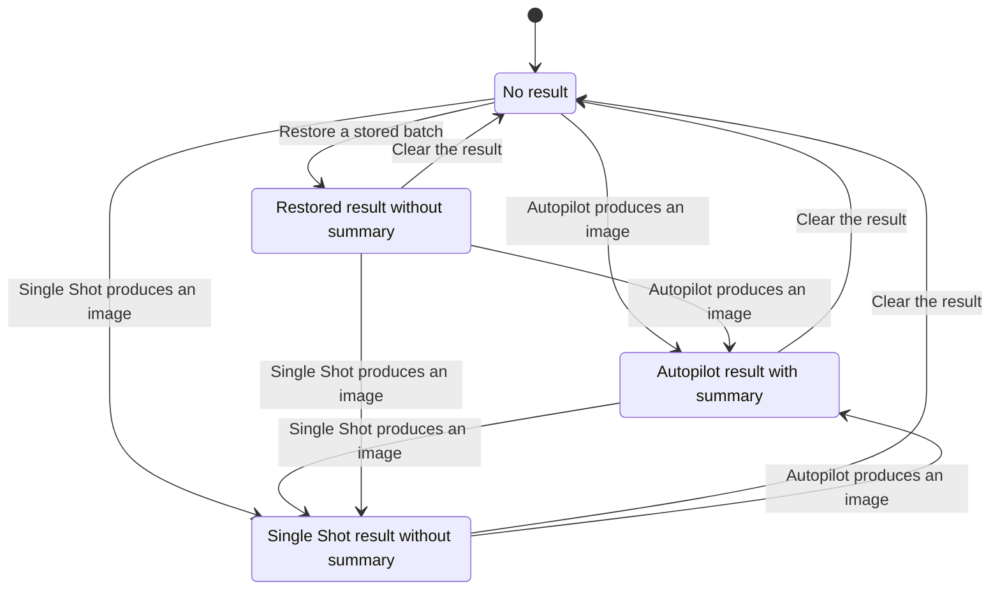

# AURA workflow state

This inventory covers the browser app's stateful workflows. A workflow qualifies when an event changes which action is legal, what appears on screen, or what work still needs to finish. Form values, filters, counters, and data classifications appear only where they participate in a workflow. Each row names the code that owns the transitions.

## Generate and Autopilot

| Workflow | States and transitions | Owner |
| --- | --- | --- |
| Mode and controls | Single Shot or Autopilot. Generation and goal translation lock mode changes. The image model determines available controls and reference limits. | [Generate view](../src/views/GenerateView.tsx), [image model controls](../src/image-models/ImageModelControls.ts) |
| Draft and result restoration | Read the draft and migrate legacy keys. Load a stored or legacy batch, then adopt it if available. Transferred references have a separate read-and-consume lifecycle. | [Generate session store](../src/generate-session/GenerateSession.ts), [Generate controller](../src/generate-session/useGenerateController.ts) |
| Result replacement consent | Request Generate, Autopilot, or Clear. Unsaved successful slots trigger confirmation. Autopilot also requires confirmation of the iteration and API call budget. | [Generate view](../src/views/GenerateView.tsx) |
| Single Shot run | Idle → prepare and snapshot inputs → request generation → adopt the batch or report failure → idle. The controller guards reentry. An all-failed attempt retains a previous usable batch. | [Generate controller](../src/generate-session/useGenerateController.ts), [image workflow](../src/image-workflow/ImageWorkflow.ts) |
| Partial image preview | Start a run, publish previews for that run, and clear the preview on completion. Starting another run invalidates the older run's callback. The provider stream decodes partial and final events before closing. | [Generate controller](../src/generate-session/useGenerateController.ts), [OpenAI stream reader](../src/utils/openai.ts) |
| Goal translation | Idle → request → apply prompt and cost context or report failure → idle. The UI locks the goal and prompt while translation is pending. The ledger carries over only when the run still uses the translated goal and prompt. | [Generate view](../src/views/GenerateView.tsx), [Generate controller](../src/generate-session/useGenerateController.ts) |
| Autopilot run and cancellation | Prepare inputs → show live candidates → select a result on satisfaction, limit, cancellation, or failure. A stop request takes effect at an iteration boundary. A failed run with a candidate can still return that image. | [Generate controller](../src/generate-session/useGenerateController.ts), [Autopilot adapter](../src/generate-session/runGenerateAutopilot.ts) |
| Autopilot iteration | Generate → evaluate → retain candidate → write lineage → stop or refine. Satisfaction wins over a concurrent stop after a completed evaluation. Evaluation and lineage failures can still leave a usable candidate. | [Autopilot session](../src/autopilot/AutopilotSession.ts) |
| Displayed result ownership | Empty, restored, Single Shot, or Autopilot batch. The live Autopilot candidate temporarily takes over the preview. Saving retains the displayed batch's summary, a run with no replacement retains the prior batch, and clear removes the batch. | [Generate controller](../src/generate-session/useGenerateController.ts) |
| Saving results | A successful slot starts unsaved. Individual or bulk save marks each completed slot saved. Partial failure retains progress and leaves remaining slots eligible for retry. | [Generate controller](../src/generate-session/useGenerateController.ts) |
| Result as reference | Check capacity → add the image and record its lineage source, or show why it cannot be added. A later run snapshots that source. | [Generate view](../src/views/GenerateView.tsx), [Generate controller](../src/generate-session/useGenerateController.ts) |
| Session transfer | Queue → snapshot draft, batch, references, and lineage → replace the session → finish or restore the snapshot. The app remounts Generate after a successful transfer. | [Generate session store](../src/generate-session/GenerateSession.ts), [app controller](../src/app/useAppController.ts) |

## Editor

| Workflow | States and transitions | Owner |
| --- | --- | --- |
| Editor source and draft | No image → open source → load and repair its draft or create a base draft. The session revision guards late imports. Dirty state derives from the current and saved compositions. | [Editor session](../src/editor/useEditorSession.ts), [draft storage](../src/editor/editorDraftStorage.ts) |
| Edit history | Past, present, and future. A new edit drops redo history. Undo and redo move snapshots between the three regions. | [Layer history](../src/editor/layers.ts#L420), [Editor session](../src/editor/useEditorSession.ts) |
| Adjustment gesture | The gesture already has explicit idle, start, and active phases. Intermediate slider changes share one undo entry. Gesture completion persists the draft. | [Editor session](../src/editor/useEditorSession.ts) |
| Layer import | Read files asynchronously → commit successful images for the current source → drain the pending import count. A source change invalidates older imports. | [Editor session](../src/editor/useEditorSession.ts) |
| Layer selection and transforms | Select one or more layers, resolve the primary layer, then drag, resize, rotate, or nudge eligible layers. The base layer stays anchored. | [Editor session](../src/editor/useEditorSession.ts), [Editor canvas](../src/editor/EditorCanvas.tsx), [layer operations](../src/editor/layers.ts) |
| Layer reorder | Drag a layer → enter or leave an eligible drop target → commit reorder or end the drag. | [Layer panel](../src/editor/LayerPanel.tsx) |
| Canvas image loading | Load the current source into a browser image → render on success. Source changes or unmounts discard late loads. | [Editor canvas](../src/editor/EditorCanvas.tsx) |
| Transform mask | Closed → render the target → paint or erase → apply or discard. Target changes invalidate pending render and export work. | [Editor view](../src/views/EditorView.tsx), [mask preparation](../src/editor/transformMask.ts) |
| AI transform and save | A shared synchronous guard admits one operation. Transform creates an AI result layer and updates draft provenance. Save renders the composition and publishes the archive result. Failure releases the guard and surfaces an error. | [Editor controller](../src/editor/useEditorController.ts), [app controller](../src/app/useAppController.ts) |

## Archive, lineage, and storage

| Workflow | States and transitions | Owner |
| --- | --- | --- |
| Archive load and retry | Load images → show results, empty state, or error → refresh on retry. Local archive actions update the displayed collection. | [Archive hook](../src/hooks/useImageArchive.ts), [Archive view](../src/views/ArchiveView.tsx) |
| Archive selection and detail | Select or deselect within the filtered list. Open an image by ID, move through adjacent images, or close. Selection excludes IDs that no longer exist. | [Archive controller](../src/archive/useArchiveController.ts) |
| Favorite | Toggle an archive image's favorite flag, persist the metadata change, and publish it to the view. | [Archive hook](../src/hooks/useImageArchive.ts), [app controller](../src/app/useAppController.ts) |
| Archive deletion | Select IDs → confirm → delete sequentially → clean up selection or show failure. If a later deletion fails, earlier deletions may already have completed. | [Archive controller](../src/archive/useArchiveController.ts), [app controller](../src/app/useAppController.ts), [confirmation dialog](../src/components/ConfirmModal.tsx) |
| ZIP export and import | Export gathers image, layer, and lineage assets before download. The import service validates the manifest, hydrates available assets, and writes images and lineage incrementally. | [Archive view](../src/views/ArchiveView.tsx), [archive transfer](../src/archive/ArchiveTransfer.ts) |
| Timeline loading and selection | Load timeline for the selected image → select an entry or report an error with retry. Cleanup invalidates late reads after a change of image. The detail dialog persists the timeline's expanded or collapsed state separately. | [Image detail](../src/components/ImageDetailModal.tsx), [timeline loader](../src/lineage/loadLineageTimeline.ts) |
| Replay, fork, and Create similar | Resolve a source and required assets → transfer into Generate or prepare the Editor → navigate. Busy destinations and unavailable inputs can block the handoff. Replay and fork already return tagged outcomes. | [Lineage navigator](../src/lineage/LineageNavigator.ts), [app controller](../src/app/useAppController.ts) |
| Archive mutation | Snapshot affected assets → write or remove assets and metadata → compensate on failure. A save spanning archive and lineage also attempts to restore the archive if the lineage write fails. | [Archive store](../src/archive/ArchiveStore.ts), [archive save](../src/archive/saveArchiveImage.ts) |
| Persistence initialization and recovery | Initialize local schemas. An optional startup recovery fetches manifests, restores metadata for available assets, and reports success or failure. Archive listing also discovers orphaned image blobs. | [Persistence initializer](../src/db/AuraPersistence.ts), [app controller](../src/app/useAppController.ts), [manifest recovery](../src/archive/recoverArchiveMetadata.ts), [archive store](../src/archive/ArchiveStore.ts) |

## App and shared interactions

| Workflow | States and transitions | Owner |
| --- | --- | --- |
| Navigation and view lifetime | Persist the active view and move focus on navigation. Generate and an open Editor can remain mounted while hidden. The Editor remounts on source ID changes and Generate remounts on transfer. | [App](../src/App.tsx), [preferences](../src/app/useAppPreferences.ts), [app controller](../src/app/useAppController.ts) |
| Theme and sidebar | Resolve the theme from browser storage or system preference before rendering. The theme toggle updates the DOM and attempts to persist the choice. Sidebar collapse changes navigation labels and persists independently. | [Startup HTML](../index.html), [Sidebar](../src/components/Sidebar.tsx) |
| Reference collection and gallery | Add, remove, replace, or clear file and preview pairs. Release object URLs when removed or unmounted. The gallery opens at an index and bounds next and previous navigation. | [Reference collection](../src/references/useReferenceImageCollection.ts), [Generate view](../src/views/GenerateView.tsx), [reference image dialog](../src/components/ReferenceImageModal.tsx) |
| File drop | Enter drag target → leave or accept images on drop. Generate references and Editor imports use separate drop targets. | [Generate view](../src/views/GenerateView.tsx), [Editor controller](../src/editor/useEditorController.ts) |
| Provider credentials | Edit draft key → save or remove → publish the credential used by the selected provider. Preferences migrate legacy key names and load browser defaults. | [Settings view](../src/views/SettingsView.tsx), [provider keys](../src/app/providerKeys.ts), [preferences](../src/app/useAppPreferences.ts) |
| Local server connection | Edit → validate and save or disconnect → test the configured URL → show connected, HTTP error, or unreachable. The typed response is separate from the in-flight UI flags. | [Settings view](../src/views/SettingsView.tsx), [local image provider](../src/image-workflow/LocalImageProvider.ts) |
| Completion notifications | Check browser permission and saved preference → request permission on opt-in → notify when a run finishes in a hidden tab. Permission readiness already has named states. | [Notification port](../src/app/CompletionNotificationPort.ts), [app controller](../src/app/useAppController.ts), [Generate controller](../src/generate-session/useGenerateController.ts) |
| Modal, animation, and focus | Open the native dialog, handle close or Escape, then restore focus. Presence keeps exiting content mounted until its animation ends. | [Modal](../src/components/Modal.tsx), [Presence](../src/components/Presence.tsx) |
| Async confirmation | Await a confirmation action while controls are busy, then close on success or surface an error and allow retry. | [Confirmation dialog](../src/components/ConfirmModal.tsx) |
| Palette keyboard navigation | Closed → open with active option → move focus, choose, or dismiss. Focus returns to the trigger after a choice or Escape. | [Palette select](../src/components/PaletteSelect.tsx) |
| Prompt clipboard feedback | Copy → show success or error → clear feedback when the image changes. | [Image detail](../src/components/ImageDetailModal.tsx) |
| Toast and download cleanup | Toasts queue, dismiss by timeout or action, and animate out. Download object URLs expire after the browser starts handling the download. | [App notifications](../src/app/useAppNotifications.ts), [Toast](../src/components/Toast.tsx), [downloads](../src/download/download.ts) |

## Decision

Give the displayed generation batch ownership of its Autopilot summary. A replacement that produces no image leaves the previous image and its summary together. A Single Shot replacement carries no Autopilot summary. The live preview names the candidate it is displaying and marks the best score separately in the thumbnail strip.

The controller holds the summary in memory alongside the batch. The saved batch format already captures the image and its lineage inputs. Reloading a batch does not reconstruct a session-only summary.

### Settled result transitions

The chart omits transitions that keep the same label, including saving and failed attempts that keep the prior image. It abstracts away live previews, persistence errors, and the ordering of concurrent requests.

When changing a workflow in this inventory, keep independent lifecycles separate. A batch can be usable while a replacement fails, and goal translation can overlap a save. Where several values describe one outcome, update them together and verify the transition through the view that consumes them.

The [Autopilot browser test](../e2e/autopilot-failure.spec.ts) compares the live candidate with the best-scoring candidate, then exercises a failed replacement, saving the retained result, and replacing it with a Single Shot result.
